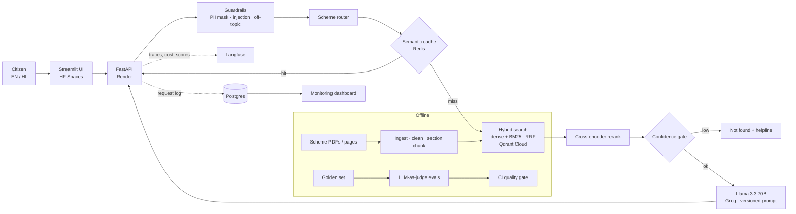

# 🇮🇳 YojanaMitra · योजनामित्र — LLMOps RAG Bot for Indian Government Schemes

> A production-style **LLMOps** project: a bilingual (English + Hindi) support bot that answers
> citizens' questions about Indian Government schemes **only from official documents, with citations**,
> plus the full operations layer around it — evaluation, prompt versioning, tracing, cost tracking,
> guardrails, semantic caching, eval-gated CI/CD and live monitoring.

**Live demo:** `https://huggingface.co/spaces/<your-hf-username>/yojanamitra` &nbsp;|&nbsp;
**API docs:** `https://yojanamitra-api.onrender.com/docs`

<!-- Add after Week 6:  -->

---

## Why this project

Citizens struggle to find correct, current information about schemes like PM-KISAN, Ayushman Bharat,
Sukanya Samriddhi or Mudra. A plain chatbot **hallucinates amounts and eligibility rules** — which is
harmful here. This project treats the LLM as a production system: every answer is grounded,
cited, traced, costed and evaluated, and no change ships unless it passes the quality gate.

## Architecture



## LLMOps features

| Area | What is implemented | Where |
|---|---|---|
| **Data pipeline** | PDF/HTML loaders, header/footer removal, Devanagari normalisation, section-aware chunking (Eligibility / Benefits / Documents / How to Apply) | `src/yojanamitra/ingestion/` |
| **Retrieval** | Hybrid dense (multilingual) + BM25 sparse search fused with RRF, scheme metadata filters, multilingual cross-encoder reranker | `src/yojanamitra/retrieval/` |
| **Grounded generation** | Citations `[S1]`, refusal when context is missing, false-premise correction, Hindi/English reply matching | `prompts/`, `generation/rag.py` |
| **Evaluation** | Golden dataset (factual, eligibility, Hindi, false-premise, unanswerable, out-of-scope, injection, PII); LLM-as-judge faithfulness / relevancy / correctness; hallucination, refusal and retrieval-hit rates | `evals/` |
| **Prompt versioning** | Langfuse prompt management (`production` label, rollback), local YAML fallback, prompt version on every trace and eval run | `prompts/`, `scripts/push_prompts_to_langfuse.py` |
| **Observability** | Langfuse traces per request (guardrails → retrieval → rerank → generation), tokens, latency, cost, user-feedback scores | `observability/tracing.py` |
| **Guardrails** | Aadhaar (Verhoeff-validated), PAN, phone, email, IFSC, bank-account masking; prompt-injection + off-topic detection; confidence gate | `guardrails/` |
| **Cost / latency** | Semantic cache (Redis or in-memory), cheap 8B classifier only when heuristics can't decide, per-request cost | `cache/`, `guardrails/topic.py` |
| **CI/CD** | Lint + unit tests + **eval gate that fails the PR on quality regression**; deploy only after CI passes | `.github/workflows/` |
| **Data drift** | Weekly job re-fetches sources, re-indexes only changed documents (content hash), re-runs evals | `scripts/refresh_index.py` |
| **Monitoring** | Queries/day, cost/day, p95 latency, cache hit rate, 👎 rate, knowledge-gap list, eval history | `ui/pages/1_Monitoring.py` |

## Results

<!-- Fill this table from evals/results/latest.json after Week 3 and Week 6 -->
| Version | Faithfulness | Correctness | Hallucination rate | Refusal accuracy | p95 latency | Cost / 1k queries |
|---|---|---|---|---|---|---|
| v1 baseline (dense only, prompt v1) | – | – | – | – | – | – |
| v2 hybrid + citations | – | – | – | – | – | – |
| v3 rerank + guardrails + cache | – | – | – | – | – | – |

## Quick start

```bash
git clone https://github.com/Dharmeshkumar2327/yojanamitra-llmops.git
cd yojanamitra-llmops
python -m venv .venv && source .venv/bin/activate      # Windows: .venv\Scripts\activate
make install                                            # or: pip install -r requirements-dev.txt && pip install -e .
cp .env.example .env                                    # add GROQ_API_KEY (free at console.groq.com)

docker compose up -d qdrant redis                       # local vector DB + cache
# put scheme PDFs into data/raw/<scheme_id>.pdf  (see data/sources.yaml)
make index                                              # ingest + index
make serve                                              # API  -> http://localhost:8000/docs
make ui                                                 # chat -> http://localhost:8501
make eval                                               # golden-set evaluation
```

Or the whole stack in one command: `docker compose up --build`

## Project structure

```
├── .github/workflows/   ci.yml (tests + eval gate) · deploy.yml · refresh-index.yml (weekly)
├── data/                sources.yaml (scheme registry) · raw/ (PDFs) · processed/
├── src/yojanamitra/
│   ├── ingestion/       loaders · cleaner · chunker · pipeline (CLI)
│   ├── retrieval/       embeddings · vector_store (hybrid) · reranker · router
│   ├── generation/      llm (Groq) · prompts (Langfuse/YAML) · rag (orchestrator) · factory
│   ├── guardrails/      pii · topic (language, greeting, injection, off-topic)
│   ├── cache/           semantic_cache (Redis / memory)
│   ├── observability/   tracing (Langfuse, no-op fallback)
│   ├── monitoring/      request_log (SQLite / Postgres)
│   └── api/             FastAPI app · schemas · rate limiter
├── prompts/             rag_v1.yaml → rag_v3.yaml (versioned prompts)
├── evals/               golden_dataset.jsonl · run_evals · judges · metrics · gate · baseline.json
├── ui/                  app.py (chat) · pages/1_Monitoring.py (dashboard)
├── loadtest/            locustfile.py
├── scripts/             push_prompts_to_langfuse.py · refresh_index.py
├── hf_space/            Dockerfile + README for the Hugging Face Space
├── docs/                WEEKLY_PLAN.md · DEPLOYMENT.md
├── Dockerfile · docker-compose.yml · render.yaml · Makefile
```

## Tech stack

Python · FastAPI · Qdrant (hybrid search) · fastembed (ONNX embeddings + reranker) · Groq (Llama 3.3 70B / 3.1 8B) ·
Langfuse (tracing, prompt management, scores) · Redis · SQLAlchemy/Postgres · Streamlit · Docker ·
GitHub Actions · Render · Hugging Face Spaces · Locust · pytest · ruff

## Disclaimer

Informational project. Answers are generated from public government documents and may be outdated;
final eligibility is decided by the implementing authority. Always verify on official portals such as
[myscheme.gov.in](https://www.myscheme.gov.in).

## Author

**Dharmesh Kumar** — Senior Tech Instructor & Data Analyst, Bengaluru ·
[GitHub](https://github.com/Dharmeshkumar2327) · [LinkedIn](https://www.linkedin.com/in/dharmesh-kumar-293a89235)
